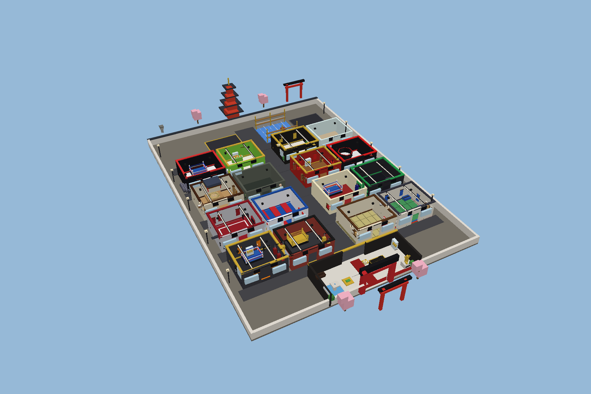
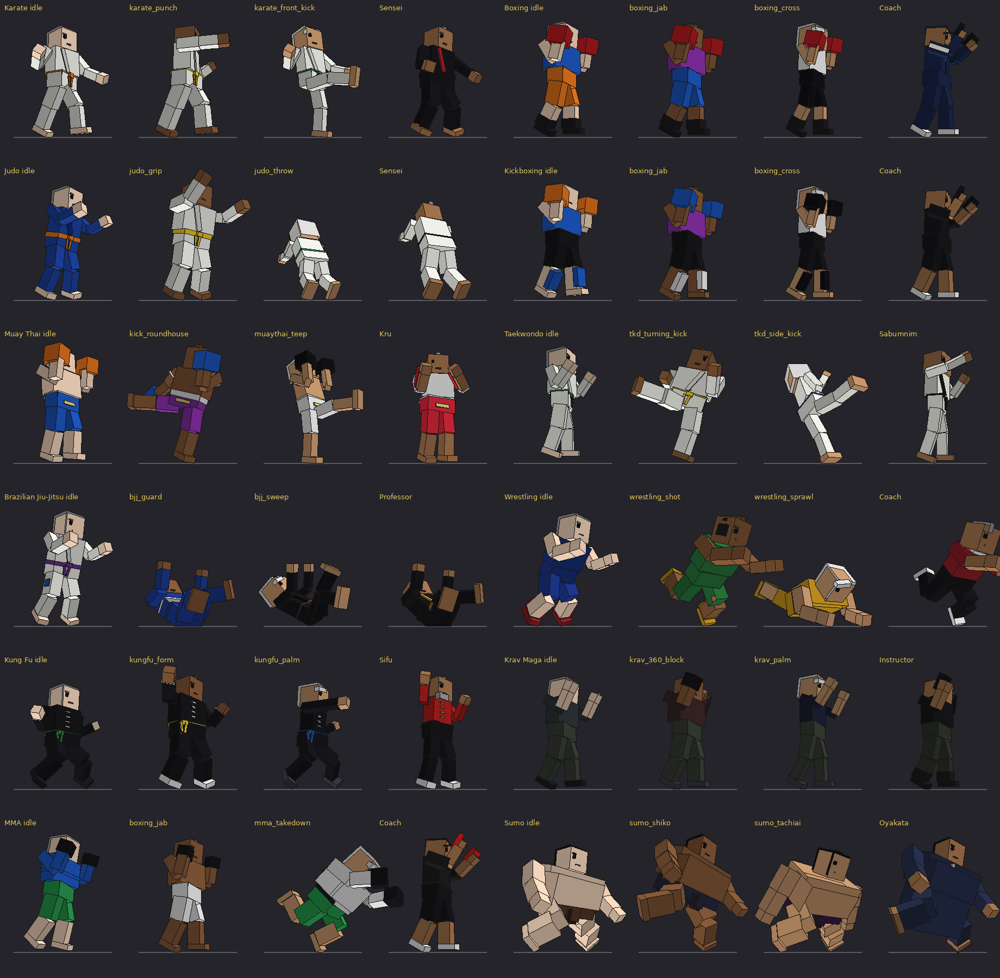

# World Martial Arts Tycoon

A Roblox business tycoon: start with one small karate dojo and grow a worldwide
martial arts empire across 10 cities, 12 disciplines and 24 room types.



The images in this README come from the game's own code (the real `Appearance`,
`Rig`, `Poses`, `PlotBuilder`, `RoomBuilder` and `Props` modules run under Lua 5.4 with a
small Roblox-maths stub, then drawn with a simple renderer). They are **not**
Roblox Studio screenshots: the game has not run in Roblox yet. See [docs/TESTING.md](docs/TESTING.md).

## Quick start

**Option A: open the place file (no tools needed)**

```sh
python3 tools/build_rbxlx.py          # writes build/WorldMartialArtsTycoon.rbxlx
```

Open `build/WorldMartialArtsTycoon.rbxlx` in Roblox Studio (File → Open from File) and press Play.

**Option B: Rojo**

```sh
rojo serve default.project.json       # then connect with the Rojo plugin in Studio
```

Then follow [docs/SETUP.md](docs/SETUP.md) (API access, lighting, max players, audio) and
[docs/MONETIZATION.md](docs/MONETIZATION.md) (Game Pass / Developer Product ids).

## What is in the game

| Area | Content |
|---|---|
| Disciplines | Karate, Boxing, Judo, Kickboxing, Muay Thai, Taekwondo, BJJ, Wrestling, Kung Fu, Krav Maga, MMA, Sumo; each with its own ranks, 5 class tiers, room style, equipment, student/trainer clothing and animations |
| Rooms | 24 types: reception, 12 discipline rooms, fitness/strength/cardio, personal coaching, VIP, lockers, showers, recovery, juice bar, merchandise shop, championship arena; 5 visual upgrade levels |
| Visitors | 8 categories (beginner → celebrity) with their own spending, expectations and patience; reception queue, class sessions, capacity, waiting, satisfaction, memberships, amenity visits |
| Trainers | 6 rarities, specialisations, abilities, levels and training; 12 named legendary masters; scouting with published odds; daily gem market with fixed prices; 3D previews |
| Cities | Small Town, Amsterdam, Rotterdam, London, Tokyo, Bangkok, Seoul, New York, Dubai, Las Vegas; each its own branch, look, lighting, rent, demand and speciality |
| Progression | Levels 1–100, discipline mastery, rebirth (prestige), daily/weekly missions, 7-day login rewards, 6 seasonal events with exclusive rewards, objective guide |
| Monetisation | 18 Game Passes (core, premium equipment, bundles), 7 Developer Products; secure ProcessReceipt with receipt idempotency |
| Social | Shared server with 8 plots, visiting, inspecting and rating academies, global + server leaderboards, server-wide announcements |
| UI | Dark/gold HUD + 15 panels, responsive for PC, tablet, phone; gamepad support |



## Project layout

```
default.project.json   Rojo project
src/shared/            ReplicatedStorage.Shared   config + shared modules
  Config/              disciplines, rooms, cities, trainers, customers, quests, events, store …
  Modules/             formulas, layout, visitor routes, appearance, rig, poses, RNG …
src/server/            ServerScriptService.Server
  Domain/              pure game logic (tested offline)
  Services/            Roblox services: data, plots, players, actions, monetization …
  World/               world, plot, room and prop builders
src/client/            StarterPlayerScripts.Client
  Controllers/         state, NPCs, world interaction, effects, audio, emotes
  UI/                  kit, HUD, panels
tests/                 offline test suite (Lua 5.4) + renderers
tools/                 static checker, place builder, audio generator, renderers
assets/audio/          original sound effects (WAV, generated)
docs/                  architecture, setup, monetisation, testing, status
```

## Checks

```sh
sh tools/test.sh       # static checks + 4600 test assertions + place build
```

Documentation: [Architecture](docs/ARCHITECTURE.md) · [Setup & publishing](docs/SETUP.md) ·
[Monetisation](docs/MONETIZATION.md) · [Testing report](docs/TESTING.md) · [Feature status & known limitations](docs/STATUS.md)
